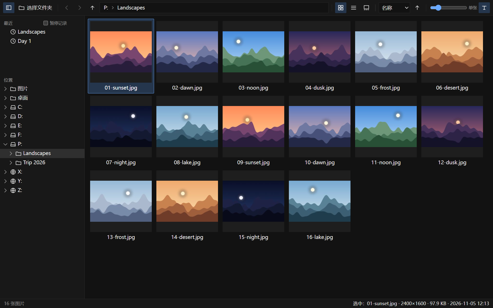
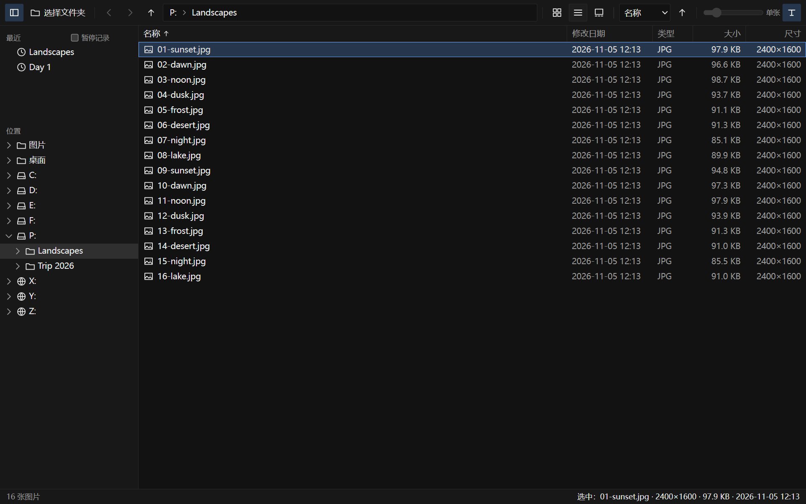
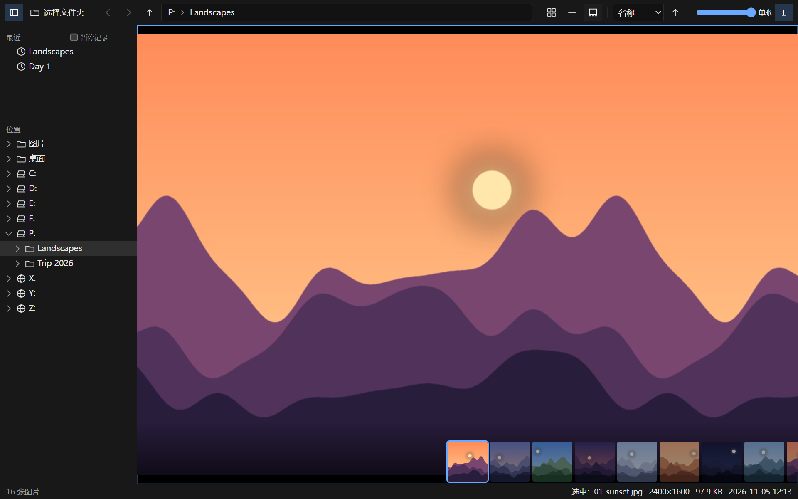
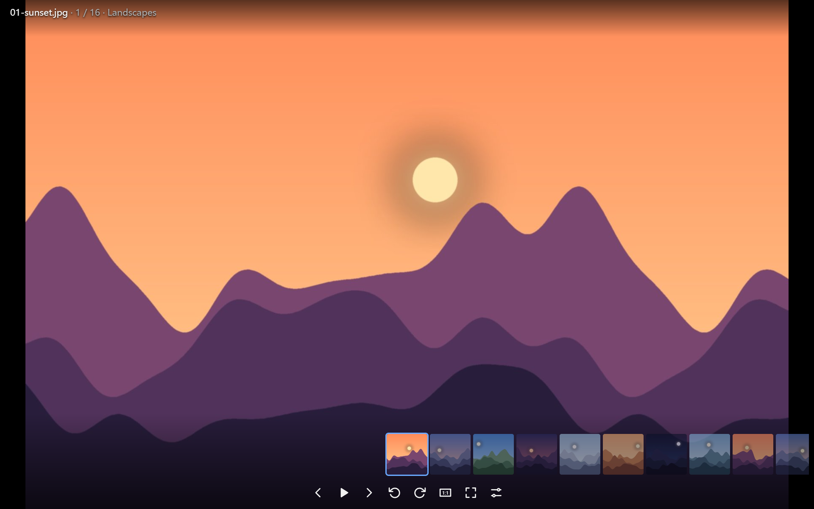
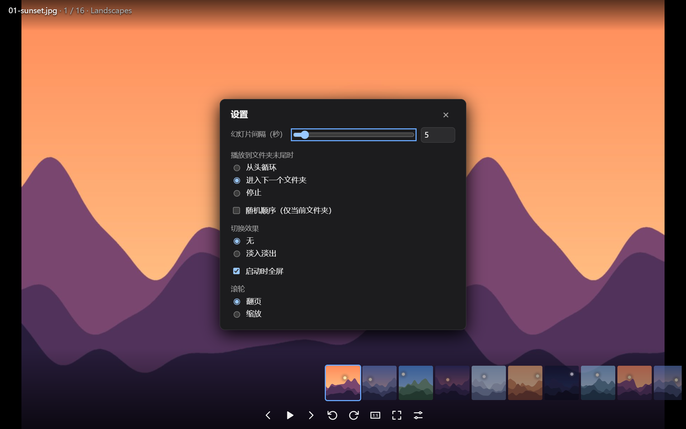

# PhotoSee

**一个只用来看照片的 Windows 看图软件：黑底、打开快、不碍事。左边目录树，右边缩略图，双击进看图，方向键翻页。**

[下载 Windows 版](https://github.com/yoyoset/photosee/releases/latest) · [更新记录](CHANGELOG.md) · [不做什么](docs/non-goals.md)



---

## 为什么做它

想要的是当年 Picasa 看图器那种感觉：点开就是图，翻页没有等待，周围什么都没有。现成的选择各差一点：

| 我要的 | 系统自带「照片」 | 功能全的看图软件 | PhotoSee |
|---|---|---|---|
| **只看图** | 带编辑、相册、云同步 | 编辑、批处理、插件一应俱全 | 只看，[明确不做](docs/non-goals.md)编辑、相册、删除 |
| **翻文件夹** | 没有目录树 | 有 | 目录树 + 缩略图 + 「下一个文件夹」 |
| **格式** | HEIC、RAW 要另装扩展 | 多 | 29 种扩展名，RAW 读内嵌预览 |
| **不碰系统设置** | — | 常常抢默认打开方式 | 只把自己加进「打开方式」列表，**不改**你的默认看图程序 |

## 截图

| 列表视图 | 单张预览 |
|---|---|
|  |  |

| 看图模式 | 设置（一共就六项） |
|---|---|
|  |  |

> 截图里的风景图是程序生成的示例图，不是真实照片。

## 功能

- **浏览**：目录树（图片、桌面、各个盘）、最近打开的文件夹（可暂停记录）、缩略图 / 列表 / 单张预览三种视图，缩略图大小可拖动，按名称 / 日期 / 大小排序，自然排序（`2.jpg` 排在 `10.jpg` 前面）
- **看图**：纯黑背景；小图不放大，按 1 图像像素 = 1 屏幕像素显示；全景图贴合短边，滚轮沿长边滚动
- **翻页不等待**：先出缩略图再出原图，相邻的图提前准备好；按住方向键快速翻时只显示缩略图，松手才解码原图（避免松手后停在错误的图上）
- **下一个文件夹**：`Ctrl+→` 按深度优先跳到下一个有图片的子文件夹，不会跑出你打开的那个根目录；幻灯片播完一个文件夹也可以自动进入下一个
- **幻灯片**：间隔 1–60 秒，可随机、可淡入淡出，坏图自动跳过
- **失败看得见**：图片损坏、缺解码器、网络盘超时，都会在图片位置显示一张说明卡，写明原因和能做什么（比如缺 HEIC 扩展时给出 Microsoft Store 链接），不会停在一张模糊的缩略图上假装正常
- **两种安装方式**：安装版（按用户安装，不要管理员权限）；绿色版（配置和缓存都在程序目录下的 `data\`，不写注册表）
- **托盘**：默认关窗口就退出；想要下次打开更快，可以在托盘菜单里勾「后台常驻」

### 支持的格式

| 类别 | 扩展名 |
|---|---|
| 常见 | jpg jpeg jpe jfif png gif webp avif bmp ico tif tiff svg |
| 新格式 / 设计 | jxl psd |
| 手机 | heic heif hif（用系统的 HEIF 扩展解码） |
| 相机 RAW（显示内嵌预览，不做 RAW 冲洗） | cr2 cr3 nef nrw arw srf sr2 dng orf rw2 raf |

GIF / WebP / AVIF 动图保持动画。

## 下载与安装

到 [Releases](https://github.com/yoyoset/photosee/releases/latest) 下载其中一个：

| 文件 | 大小 | 说明 |
|---|---|---|
| `PhotoSee_<版本>_x64-setup.exe` | 约 4 MB | 安装版。按当前用户安装，不需要管理员权限；会把 PhotoSee 加进图片的「打开方式」列表 |
| `PhotoSee-<版本>-portable.zip` | 约 6 MB | 绿色版。解压后双击 `photosee.exe`；设置、缩略图缓存都放在旁边的 `data\` 文件夹 |

系统要求：Windows 10/11 x64（在 Windows 11 上开发和测试），需要 WebView2（Windows 11 自带；没有的话安装版会自动下载）。

> 程序**没有代码签名**，Windows 可能提示「未知发布者」。Release 页附了 SHA256，可以核对。

想让双击图片直接用 PhotoSee 打开：右键图片 →「打开方式」→「选择其他应用」→ PhotoSee → 勾「始终使用」。安装程序不会替你改这个设置。

## 快捷键

| 操作 | 按键 |
|---|---|
| 下一张 / 上一张 | `→` `←` `空格` `Backspace` `PgDn` `PgUp`，或滚轮 |
| 第一张 / 最后一张 | `Home` `End` |
| 下一个 / 上一个文件夹 | `Ctrl+→` `Ctrl+←`，或 `]` `[` |
| 全屏 | `F` `F11` `Enter` |
| 幻灯片 | `S` |
| 旋转（只改显示，不写回文件） | `R` / `Shift+R` |
| 适应窗口 / 实际大小 | `0` / `1`，或双击 |
| 放大 / 缩小 | `+` `-`，或 `Ctrl+滚轮` |
| 图片信息 / 快捷键帮助 | `I` / `?` |
| 一层层退出 | `Esc`（每按一次退一层：面板 → 幻灯片 → 缩放 → 全屏） |

## 实测数据

测试机：Xeon E5-2698 v3（2014 年的服务器 CPU）、RTX 3060、2560×1440，Windows 11。都是 release 构建上量的。

| 项目 | 结果 |
|---|---|
| 双击一张 2400 万像素 JPEG（程序没在运行）→ 看见缩略图 | 1.20–1.45 s，11 次 |
| 同上 → 看见清晰原图 | 1.34–1.62 s，原图比缩略图晚 0.1–0.25 s |
| 后台常驻时再次打开 → 看见缩略图 | 151–203 ms |
| 后台常驻时的内存（含 WebView2 全部进程，私有工作集） | 97–117 MiB |
| 安装包 / 绿色版 | 4.15 MiB / 5.84 MiB |
| 自动化测试 | Rust 247 项、前端 466 项，全部通过 |

冷启动的大头是 WebView2：单独计时，程序自己的服务和读文件 40 ms 内就完成，WebView2 创建窗口要约 0.65 s。

## 隐私

- 不联网。看图服务只监听本机 `127.0.0.1`，每次启动生成随机令牌，别的程序拿不到你的图片
- 不上传、不统计、不检查更新
- 只读文件，**不修改、不删除、不移动**任何图片（旋转只改显示）
- 本地只存两样东西：设置（含最近打开的文件夹）和缩略图缓存。安装版在 `%LOCALAPPDATA%\PhotoSee`，绿色版在程序旁边的 `data\`。删掉就清空

## 已知限制

如实写在这里，不藏：

- **只有 Windows 版**。代码里核心部分是跨平台的，但 macOS / Linux 的外壳还没做
- **RAW 只在合成样本上测过**，还没拿各家相机的真实文件逐一验证。打不开的话欢迎提 issue，附上相机型号
- **HEIC** 依赖系统的「HEIF 图像扩展」和「HEVC 视频扩展」，没装时会提示去 Microsoft Store 装
- **AVIF** 能看，但缩略图是直接用原图缩的，大文件夹里会慢一些
- **冷启动 1.2–1.5 秒**，大半是 WebView2 的启动时间，我们这边压不下去；在意的话打开托盘里的「后台常驻」
- **网络盘（SMB / NAS）** 能用，有超时提示和重试，但还没在真实 NAS 上测过速度
- 读屏软件（讲述人、NVDA）还没完整走过一遍

## 反馈

遇到问题请到 [Issues](https://github.com/yoyoset/photosee/issues) 提，最好附上：Windows 版本、出问题的图片格式（能附样本更好）、看到的提示卡内容（点「技术细节」可以展开）。

## 从源码构建

需要 Rust 1.92（`rust-toolchain.toml` 已固定）、Node.js 20+、Visual Studio 的 C++ 生成工具。

```powershell
powershell -File scripts/check.ps1      # 格式、clippy、全部测试、前端构建
powershell -File scripts/package.ps1    # 生成安装包和绿色版 zip
```

结构：`core/`（解码、缩略图、目录遍历，纯 Rust）→ `server/`（本机 HTTP 接口，axum）→ `web/`（界面，TypeScript，不用框架）→ `app/`（Tauri 2 外壳、托盘、安装包）。接口约定在 [docs/api.md](docs/api.md)，交互细节和每个数字的来由在 [docs/ux-spec.md](docs/ux-spec.md)，每个依赖为什么要在 [docs/deps.md](docs/deps.md)。

## 许可

[MIT](LICENSE)
